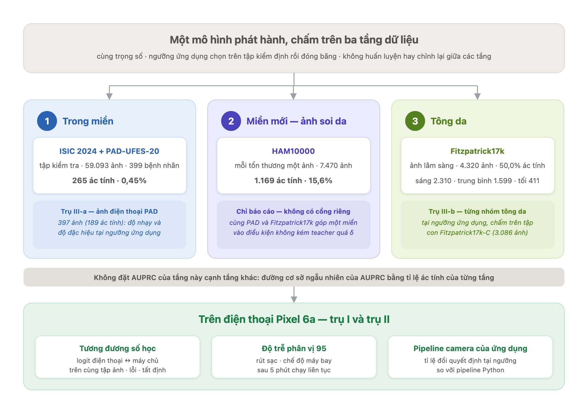

# ĐỀ CƯƠNG LUẬN VĂN (BẢN RÚT GỌN)

**Tên đề tài:** Phát hiện ung thư da trên thiết bị biên sử dụng mô hình học sâu kết hợp chưng cất tri thức
(*Knowledge-Distilled Deep Learning Models for Skin Cancer Detection on Edge Devices*)

**Học viên:** Đặng Quang Hưng · MSHV 230101006 · **Người hướng dẫn khoa học:** TS. Nguyễn Thanh Bình

*Cập nhật ngày 08/10/2026. Bản này thay cho bản rút gọn trước và phản ánh ba điều chỉnh lớn của đề tài kể từ bản đề cương đầy đủ cập nhật ngày 19/09/2026. Thứ nhất, theo góp ý của người hướng dẫn ngày 21/09, câu hỏi nghiên cứu được định hướng lại quanh việc mô hình chạy tốt trên điện thoại. Thứ hai, ngày 22/09, đề tài phát hiện và khắc phục sự cố rò rỉ bệnh nhân trong cách chia dữ liệu cũ. Thứ ba, ngày 03–04/10, đề tài xây dựng bộ tiêu chí đánh giá ba trụ, đo tại đúng ngưỡng quyết định của ứng dụng. Bản đề cương đầy đủ và toàn văn luận văn hiện chưa được cập nhật theo các điều chỉnh này.*

---

## 1. NỘI DUNG

### a. Giới thiệu về đề tài

Ung thư da là một gánh nặng bệnh tật lớn trên toàn cầu. Theo số liệu GLOBOCAN 2022, trong năm 2022 thế giới ghi nhận khoảng 331.722 ca mắc mới và 58.667 ca tử vong do u hắc tố ác tính (*melanoma*), loại ung thư đứng thứ mười bảy về số ca mắc; ung thư da không phải hắc tố đứng thứ năm, với khoảng 1.234.533 ca mắc mới và 69.416 ca tử vong [28]. Ở phần lớn các quốc gia, số ca mắc melanoma đứng yên hoặc tăng lên trong khi tỉ lệ tử vong đã giảm trong ba thập kỷ gần đây, và phần giảm ấy được quy cho việc nhận biết yếu tố nguy cơ, chẩn đoán sớm cùng tiến bộ trong điều trị [5].

Thế nhưng phát hiện sớm lại dựa vào một nguồn lực khan hiếm. Ước tính khoảng 3 tỉ người trên thế giới không tiếp cận được dịch vụ chăm sóc da liễu [4]. Ngay cả khi được khám, độ chính xác chẩn đoán melanoma bằng mắt thường chỉ khoảng 60%; soi da (*dermoscopy*) nâng độ chính xác lên đáng kể, nhưng chỉ khi người đọc ảnh có kinh nghiệm — với người chưa được đào tạo, soi da không tốt hơn khám bằng mắt thường [13]. Học sâu mở ra một hướng bù đắp khoảng thiếu hụt này: Esteva và cộng sự cho thấy một mạng nơ-ron tích chập huấn luyện đầu–cuối từ ảnh có thể đạt hiệu năng ngang 21 bác sĩ da liễu có chứng chỉ trên hai bài toán phân loại nhị phân [8]. Từ đó, đề tài hướng tới một kịch bản sử dụng cụ thể: một ứng dụng Android hoạt động **hoàn toàn ngoại tuyến**, nhận ảnh tổn thương chụp bằng camera điện thoại và chỉ đưa ra một khuyến nghị nhị phân — "nên đi khám" hoặc "không thấy dấu hiệu đáng ngờ". Ứng dụng không thay thế bác sĩ mà đóng vai trò một công cụ sàng lọc ban đầu; và vì suy luận diễn ra ngay trên máy, ảnh tổn thương — loại dữ liệu y tế nhạy cảm về quyền riêng tư [19] — không phải rời khỏi thiết bị của người dùng.

Con đường từ một mô hình chính xác trong phòng thí nghiệm đến một ứng dụng như vậy vấp phải hai trở ngại. Trở ngại thứ nhất mang tính **tài nguyên**. Những hệ thống đạt độ chính xác cao nhất thường quá lớn để chạy trên điện thoại; chẳng hạn, giải pháp thắng cuộc thi SIIM-ISIC 2020 là một tổ hợp (*ensemble*) nhiều mạng tích chập với các backbone và kích thước đầu vào khác nhau [10]. Đưa suy luận lên máy chủ thì gỡ được ràng buộc tài nguyên, nhưng lại đòi hỏi kết nối mạng và buộc phải gửi ảnh đi, trái với chính yêu cầu ngoại tuyến nêu trên. Mô hình vì thế phải được **thu gọn** — ở đề tài này chủ yếu bằng kỹ thuật **chưng cất tri thức** (*Knowledge Distillation* — KD) [11], trong đó một mô hình *giáo viên* (teacher) dung lượng lớn truyền đầu ra đã được làm mềm của nó cho một mô hình *học sinh* (student) nhỏ gọn — rồi **triển khai** lên thiết bị. Bước triển khai không chỉ là thủ tục: trong quá trình thực hiện đề tài, một student sau khi xuất sang ExecuTorch với backend XNNPACK đã cho logit khoảng −2,2·10¹⁰ thay vì −3,15 như mô hình PyTorch gốc, trong khi quá trình xuất không báo bất kỳ lỗi nào. Chỉ có phép đối chiếu với kết quả trên máy chủ mới phát hiện được sai lệch này.

Trở ngại thứ hai mang tính **dữ liệu**. Một mô hình học trên một nguồn ảnh thường suy giảm khi gặp ảnh từ nguồn khác — khác máy chụp, khác điều kiện ánh sáng, khác tông da — mà đó lại chính là hoàn cảnh thường ngày của một ứng dụng camera. Văn liệu đã ghi nhận hiện tượng này: trên Fitzpatrick17k, mô hình phân loại bệnh da chính xác nhất trên những tông da giống với tông da trong dữ liệu huấn luyện của nó [9]; trên bộ DDI, các mô hình AI da liễu hiện đại bộc lộ hạn chế đáng kể, nhất là trên da tối màu và các bệnh ít gặp, và việc tinh chỉnh mô hình trên chính ảnh DDI giúp thu hẹp khoảng cách giữa da sáng và da tối [4]. Loại ảnh cũng là một trục dịch chuyển: ảnh soi da như HAM10000 [24] khác hẳn ảnh chụp bằng camera thông thường, còn ảnh của ISIC 2024 SLICE-3D được cắt từ ảnh chụp toàn thân 3D và có độ phân giải quang học tương đương ảnh điện thoại [14]. Bên cạnh đó, dữ liệu sàng lọc có tỉ lệ ca ác tính rất thấp — khoảng 0,39% trong dữ liệu chính của đề tài — nên một mô hình đoán mọi ảnh là lành tính đã đạt trên 99% accuracy mà không phát hiện được ca nào. Đề tài vì thế không dùng accuracy, mà đánh giá bằng các chỉ số phản ánh đúng lớp hiếm [22] và bằng độ nhạy, độ đặc hiệu tại chính ngưỡng quyết định mà ứng dụng sử dụng.

Đề tài lấy hai trở ngại này làm trục nghiên cứu. Đây là một điều chỉnh có chủ đích: đề cương trước lấy hiệu quả của chưng cất tri thức làm câu hỏi trung tâm, và sau góp ý của người hướng dẫn ngày 21/09/2026, đề tài được định hướng lại quanh việc mô hình chạy tốt trên điện thoại. Trong khung mới, chưng cất tri thức là một giải pháp cho trở ngại thứ nhất chứ không phải đối tượng nghiên cứu tự thân; hiệu quả của nó vẫn được đo, nhưng bằng phép so sánh ghép cặp với một nhánh đối chứng không dùng KD. Cũng vì vậy, "chạy tốt trên điện thoại" không được để ở dạng một khẩu hiệu: đề tài định nghĩa nó thành một bộ tiêu chí đo được — tốc độ trên máy thật, sự trùng khớp giữa điện thoại và máy chủ, cùng độ nhạy và độ đặc hiệu tại ngưỡng của ứng dụng trên ảnh điện thoại và trên ảnh lâm sàng khác nguồn, phần sau xét riêng từng nhóm tông da (tiểu mục 4 của mục c). Hai trở ngại nói trên được chuyển thành hai câu hỏi nghiên cứu ở mục sau.

### b. Mục tiêu của đề tài

Đề tài được dẫn dắt bởi hai câu hỏi nghiên cứu trung tâm, chốt ngày 03/10/2026:

> *Câu hỏi 1. Làm thế nào để thu gọn và triển khai mô hình học sâu phân loại tổn thương da lên thiết bị di động?*
>
> *Câu hỏi 2. Làm cách nào duy trì hiệu năng chẩn đoán ổn định trên miền ảnh chụp từ camera thực tế?*

Để trả lời hai câu hỏi trên, đề tài đặt ra bốn mục tiêu cụ thể. Thứ nhất, xây dựng một quy trình hai giai đoạn, trong đó mô hình *giáo viên* (teacher) chưng cất tri thức sang mô hình *học sinh* (student), cho bài toán phân loại nhị phân lành tính/ác tính; quy trình phải tái lập được và cho ra một student đủ nhẹ để chạy ngoại tuyến trên Android. Thứ hai, định nghĩa một cách **đo được** khái niệm "mô hình chạy tốt trên điện thoại" — bộ tiêu chí ba trụ trình bày ở tiểu mục 4 của mục c — rồi chấm mô hình ứng viên theo đúng định nghĩa đó, kèm khoảng tin cậy. Thứ ba, làm rõ phần nào của khoảng cách hiệu năng khi đổi miền ảnh có thể thu hẹp bằng dữ liệu, bằng tăng cường ảnh hay bằng chiến lược lấy mẫu, và phần nào vẫn còn lại. Thứ tư, đánh giá tính công bằng theo tông da và hành vi của mô hình tại chính ngưỡng quyết định mà ứng dụng sử dụng.

Bộ câu hỏi con chi tiết dưới hai câu hỏi trung tâm hiện vẫn ở dạng đề xuất, chưa được duyệt. Sáu câu hỏi Q1–Q6 của đề cương trước, vốn lấy chưng cất tri thức làm trung tâm, không bị loại bỏ mà sẽ được chuyển thành bằng chứng cho các câu hỏi con.

### c. Nội dung nghiên cứu của đề tài

Nội dung nghiên cứu được trình bày theo bốn bước nối tiếp nhau: phát biểu bài toán cùng các thách thức của nó, lựa chọn dữ liệu, giải pháp đề xuất cho từng câu hỏi nghiên cứu, và cuối cùng là bộ tiêu chí dùng để kiểm chứng xem giải pháp có thực sự tạo ra một mô hình "chạy tốt trên điện thoại" hay không.

#### 1. Phát biểu bài toán

Đề tài đặt bài toán trong khung **phân loại nhị phân**:

> Cho một ảnh tổn thương da $x \in \mathbb{R}^{224 \times 224 \times 3}$, xây dựng một hàm $f_\theta$ cho ra **một logit duy nhất** $z = f_\theta(x) \in \mathbb{R}$, sao cho $\sigma(z) = 1/(1 + e^{-z})$ ước lượng xác suất tổn thương là **ác tính**.

Ứng dụng so xác suất này với một **ngưỡng cố định** (cách chọn ngưỡng được trình bày ở tiểu mục 3) và chỉ hiển thị kết luận nhị phân, không hiển thị con số phần trăm. Trên ảnh điện thoại PAD-UFES-20, nhóm ác tính gồm u hắc tố, ung thư biểu mô tế bào đáy (BCC) và ung thư biểu mô tế bào vảy (SCC); các bộ dữ liệu khác dùng nhãn lành/ác tính của chính bộ đó.

Bài toán mang bốn thách thức, và mỗi thách thức được nhắm tới ở một phần cụ thể của đề tài:

1. **Mất cân bằng lớp cực đoan.** Tỉ lệ ác tính trong dữ liệu chính chỉ khoảng **0,39%**. Thách thức này được xử lý bằng hàm mất mát focal và bộ lấy mẫu cân bằng lại ở mỗi epoch (tiểu mục 3).
2. **Rò rỉ dữ liệu.** Mọi ảnh của cùng một bệnh nhân phải nằm cùng một phía trong mỗi phép chia; nếu không, mô hình có thể "nhận diện bệnh nhân" thay vì "nhận diện tổn thương". Thách thức này được xử lý bằng cách chia dữ liệu theo bệnh nhân (mục d).
3. **Ràng buộc tài nguyên của điện thoại.** Thách thức này ứng với câu hỏi nghiên cứu thứ nhất và được xử lý bằng chưng cất tri thức cùng triển khai ngoại tuyến (tiểu mục 3).
4. **Dịch chuyển miền** giữa ảnh huấn luyện và ảnh camera của người dùng. Thách thức này ứng với câu hỏi nghiên cứu thứ hai và được xử lý bằng chiến lược dữ liệu (tiểu mục 2 và 3).

Các biện pháp nêu trên hiệu quả đến đâu được đo bằng bộ tiêu chí ở tiểu mục 4.

#### 2. Dữ liệu

Vì thách thức dịch chuyển miền, đề tài không dựa vào một nguồn ảnh duy nhất mà phối hợp năm bộ dữ liệu, mỗi bộ giữ một vai trò riêng (Bảng 1). ISIC 2024 SLICE-3D [12, 14] và PAD-UFES-20 [18] được dùng cho cả huấn luyện, kiểm định và kiểm tra; trong đó PAD-UFES-20, gồm ảnh chụp bằng điện thoại, là miền gần với ứng dụng nhất. DDI [4] chỉ được bổ sung vào phần huấn luyện nhằm tăng độ đa dạng về tông da. Ngược lại, HAM10000 [24] và Fitzpatrick17k [9] hoàn toàn không tham gia huấn luyện; chúng được giữ riêng để đánh giá ngoài miền và đánh giá công bằng, nhờ đó phản ánh trung thực hơn hoàn cảnh mô hình gặp ảnh từ một nguồn lạ.

**Bảng 1**. Năm bộ dữ liệu và vai trò của từng bộ

| Bộ dữ liệu | Đặc điểm ảnh | Vai trò |
|---|---|---|
| ISIC 2024 SLICE-3D [12, 14] | ảnh cắt từ chụp toàn thân 3D (không soi da), độ phân giải quang học tương đương ảnh điện thoại | huấn luyện, kiểm định, kiểm tra |
| PAD-UFES-20 [18] | ảnh chụp bằng điện thoại | huấn luyện, kiểm định, kiểm tra — miền gần ứng dụng nhất |
| DDI (Stanford) [4] | ảnh lâm sàng đa dạng tông da, nhãn xác nhận bằng mô bệnh học | chỉ huấn luyện (656 ảnh, 171 ác tính) |
| HAM10000 [24] | ảnh soi da (dermoscopy) | chỉ đánh giá ngoài miền |
| Fitzpatrick17k [9] | ảnh lâm sàng từ các atlas trên web, có nhãn tông da | chỉ đánh giá ngoài miền và công bằng theo tông da |

#### 3. Giải pháp đề xuất

Giải pháp gồm ba khâu. Khâu thu gọn và khâu triển khai phục vụ câu hỏi nghiên cứu thứ nhất; khâu thích ứng với ảnh camera phục vụ câu hỏi thứ hai.

**Thu gọn mô hình bằng chưng cất tri thức.** Student được huấn luyện bằng một hàm mất mát gồm hai thành phần: một thành phần học từ nhãn thật và một thành phần học từ teacher. Gọi $z_s$ và $z_t$ lần lượt là logit của student và của teacher trên cùng một ảnh, $y \in \{0, 1\}$ là nhãn thật và $\sigma$ là hàm sigmoid. Hàm mất mát tổng là

$$\mathcal{L} = \lambda\,\mathcal{L}_{\text{hard}} + (1 - \lambda)\,T^2\,\mathcal{L}_{\text{soft}}, \qquad (1)$$

trong đó $\lambda \in [0, 1]$ chia phần giữa hai thành phần: $\lambda$ càng lớn, student càng dựa vào nhãn thật; $\lambda$ càng nhỏ, student càng bám theo teacher (luận văn ký hiệu trọng số này là $\alpha$; ở đây dùng $\lambda$ để không trùng với $\alpha$ của focal loss bên dưới). Khi $\lambda = 1$, chỉ còn thành phần nhãn cứng, tức đúng hàm mất mát của nhánh đối chứng không dùng KD. Giá trị của (1) được lấy trung bình trên các ảnh của một batch.

*Thành phần nhãn cứng* là focal loss [16]. Đặt $p = \sigma(z_s)$ là xác suất ác tính mà student dự đoán, rồi định nghĩa

$$p_y = \begin{cases} p & \text{nếu } y = 1 \\ 1 - p & \text{nếu } y = 0 \end{cases}, \qquad \alpha_y = \begin{cases} \alpha & \text{nếu } y = 1 \\ 1 - \alpha & \text{nếu } y = 0 \end{cases}, \qquad (2)$$

$$\mathcal{L}_{\text{hard}} = -\,\alpha_y\,(1 - p_y)^{\gamma}\,\log p_y. \qquad (3)$$

Ở đây $p_y$ là xác suất student gán cho đúng lớp thật, nên $-\log p_y$ chính là entropy chéo nhị phân thông thường. Hệ số $(1 - p_y)^{\gamma}$, với $\gamma \ge 0$ là *tham số tập trung*, làm tắt dần đóng góp của những ảnh student đã phân loại đúng và chắc chắn ($p_y$ gần 1), để gradient dồn về các ảnh còn khó; với $\gamma = 0$, (3) trở về entropy chéo có trọng số. Hệ số $\alpha_y$ là trọng số theo lớp: ảnh ác tính nhận $\alpha$, ảnh lành tính nhận $1 - \alpha$.

*Thành phần mềm* buộc student bám theo teacher [11]. Cả hai logit được chia cho *nhiệt độ* $T > 0$ trước khi qua sigmoid:

$$\tilde{y} = \sigma(z_t / T), \qquad \tilde{p} = \sigma(z_s / T), \qquad (4)$$

$$\mathcal{L}_{\text{soft}} = \mathrm{BCE}(\tilde{p}, \tilde{y}) = -\big[\,\tilde{y}\log\tilde{p} + (1 - \tilde{y})\log(1 - \tilde{p})\,\big]. \qquad (5)$$

$\tilde{y}$ là *nhãn mềm*: xác suất ác tính mà teacher đưa ra sau khi được làm mềm; vì teacher được đóng băng, $\tilde{y}$ là một hằng số đối với student. $\tilde{p}$ là xác suất tương ứng của student ở cùng nhiệt độ. Chia logit cho $T$ kéo xác suất về phía 0,5, nên $T$ càng lớn thì nhãn mềm càng "mềm"; $T = 1$ là không làm mềm. Vì (5) nhỏ nhất khi $\tilde{p} = \tilde{y}$, tức $z_s = z_t$, thành phần này kéo logit của student về logit của teacher. Cuối cùng, hệ số $T^2$ trong (1) bù cho việc chia logit: đạo hàm của (5) theo $z_s$ bằng $(\tilde{p} - \tilde{y})/T$, và khi $T$ lớn so với hai logit thì hiệu $\tilde{p} - \tilde{y}$ chỉ còn xấp xỉ $(z_s - z_t)/(4T)$, nên gradient co lại theo tỉ lệ $1/T^2$; nhân thêm $T^2$ đưa gradient về xấp xỉ $(z_s - z_t)/4$, không còn phụ thuộc vào $T$.

*Giá trị dùng trong luận văn.* Bốn tham số được đặt $\lambda = 0{,}3$, $T = 4$, $\gamma = 2$ và $\alpha = 0{,}25$, cố định cho mọi cặp teacher–student chứ không dò riêng cho từng cặp, để chênh lệch giữa các cặp không lẫn với công sức dò tham số. Thay các giá trị này vào (1)–(5), hàm mất mát thực tế là

$$\mathcal{L} = 0{,}3\cdot\mathcal{L}_{\text{hard}} + 0{,}7 \cdot 16 \cdot \mathrm{BCE}\big(\sigma(z_s/4),\ \sigma(z_t/4)\big),$$

$$\mathcal{L}_{\text{hard}} = -\,\alpha_y\,(1 - p_y)^{2}\log p_y, \qquad \alpha_y \in \{0{,}25;\ 0{,}75\}.$$

Mỗi con số mang một ý nghĩa cụ thể:

- $\lambda = 0{,}3$: trọng số 0,3 dành cho nhãn thật và 0,7 dành cho teacher — student chủ yếu học theo teacher, nhưng vẫn được neo vào nhãn thật.
- $T = 4$: hai ảnh mà teacher cho logit 2 và 6 có xác suất 0,881 và 0,998 khi không làm mềm, cùng dồn về sát 1 và chỉ cách nhau 0,117; ở $T = 4$, chúng thành 0,622 và 0,818, cách nhau 0,195. Làm mềm giãn khoảng cách giữa "khá chắc" và "rất chắc" của teacher, để chênh lệch độ tự tin ấy đủ lớn mà tác động lên gradient của student.
- $T^2 = 16$: hệ số đứng trước thành phần mềm là $0{,}7 \times 16 = 11{,}2$. Con số này không có nghĩa thành phần mềm nặng gấp 16 lần; nó bù lại phần gradient đã co lại do chia logit cho 4 — đúng một thừa số $1/T$ từ phép chia, và xấp xỉ thêm một thừa số $1/T$ nữa khi logit nhỏ so với $T$, như phép tính đạo hàm ở trên.
- $\gamma = 2$: một ảnh đã được phân loại đúng với $p_y = 0{,}9$ chỉ giữ $(1 - 0{,}9)^2 = 0{,}01$ — tức 1% — đóng góp so với entropy chéo có trọng số $\alpha_y$; ảnh ở $p_y = 0{,}5$ giữ 25%; còn ảnh bị phân loại sai với $p_y = 0{,}1$ giữ 81%.
- $\alpha = 0{,}25$: ảnh ác tính nhận trọng số 0,25 và ảnh lành tính 0,75. Đây là một trọng số, không phải tỉ lệ lớp (tỉ lệ ác tính thật chỉ khoảng 0,39%); nó tác động chồng lên bộ lấy mẫu 1:5 trình bày ở đoạn sau, nên trọng số thực tế của lớp ác tính là tích của hai cơ chế, không phải riêng con số 0,25.

Teacher được đóng băng suốt quá trình huấn luyện student. Nhóm teacher gồm ba kiến trúc dung lượng lớn, còn nhóm student gồm bốn kiến trúc được tối ưu cho thiết bị di động; mọi backbone đều được nạp từ thư viện timm [29]. Bảng 2 liệt kê bảy kiến trúc cùng số tham số của chúng.

**Bảng 2**. Các kiến trúc teacher và student

| Vai trò | Kiến trúc | Số tham số (triệu) |
|---|---|---:|
| Teacher | EfficientNetV2-M [23] | 54 |
| Teacher | ConvNeXtV2-Base [31] | 89 |
| Teacher | MaxViT-Base [25] | 120 |
| Student | MobileNetV4-Conv-Medium [21] | 9,2 |
| Student | FastViT-SA12 [26] | 10,9 |
| Student | EfficientFormerV2-S2 [15] | 12,6 |
| Student | RepViT-M1.0 [27] | 6,8 |

*Chú thích*: Số tham số lấy từ bảng kết quả ImageNet-1K trong bài báo gốc của từng kiến trúc, tức là của mô hình phân loại 1000 lớp. Mô hình trong đề tài được nạp từ timm và có đầu ra một logit, nên số tham số thực tế không trùng hoàn toàn với các con số này.

Để tác động của chưng cất có thể được tách bạch, mỗi student đều có một **nhánh đối chứng** không dùng KD (*baseline*), giống hệt về dữ liệu, seed và siêu tham số.

**Thích ứng với ảnh camera.** Một student nhỏ gọn chỉ hữu ích khi nó vẫn đúng trên loại ảnh mà người dùng thực sự chụp. Vì vậy, đề tài trộn ảnh điện thoại PAD-UFES-20 và ảnh lâm sàng DDI vào tập huấn luyện. Tuy nhiên, hai nguồn này nhỏ hơn ISIC 2024 rất nhiều, nên nếu lấy mẫu ngẫu nhiên thì ảnh lành của chúng gần như bị ảnh lành ISIC lấn át. Bộ lấy mẫu của đề tài vì thế làm hai việc. Thứ nhất, nó giữ tỉ lệ ác tính:lành tính khoảng **1:5** ở mỗi epoch, qua đó giảm mức mất cân bằng lớp. Thứ hai, nó **phân tầng theo nguồn ảnh**: mỗi nguồn thiểu số (PAD, DDI) được rút tới năm ảnh lành cho mỗi ca ác của chính nó, hoặc toàn bộ ảnh lành nếu ít hơn, còn phần ảnh lành còn lại lấy từ ISIC. Checkpoint của mô hình phát hành được chọn theo diện tích dưới đường cong precision–recall (**AUPRC**) trên tập kiểm định — chỉ số phản ánh trung thực hơn AUC-ROC khi lớp dương hiếm [22].

**Triển khai lên điện thoại.** Mô hình được xuất sang ExecuTorch [20] với backend XNNPACK, và kết quả số học trên điện thoại phải được kiểm tra tương đương với máy chủ trước khi sử dụng, bởi một lần xuất thành công chưa bảo đảm mô hình trên máy vẫn cho cùng kết quả. Ứng dụng Android viết bằng Kotlin, chạy hoàn toàn ngoại tuyến, có bước kiểm tra chất lượng ảnh: chặn ảnh hỏng hoặc quá nhỏ; cảnh báo ảnh mờ, gần như đồng màu, thiếu tương phản, quá tối hoặc quá sáng, hoặc lệch tâm khi chụp bằng camera. Riêng cơ chế từ chối ảnh không phải tổn thương da (cổng ngoài phân phối) hiện mới ở mức thiết kế. Cuối cùng, ngưỡng quyết định của ứng dụng được chọn trên tập kiểm định sao cho độ nhạy trên ảnh điện thoại đạt 90%, rồi **đóng băng**; mọi đánh giá về mức độ "đúng với người dùng" ở tiểu mục 4 đều được đo tại chính ngưỡng này.

#### 4. Kiểm chứng trên thiết bị biên

Để câu hỏi trung tâm có thể kiểm chứng, đề tài không đánh giá mô hình bằng một chỉ số tổng hợp duy nhất mà định nghĩa "chạy tốt" qua **ba trụ**, đi từ điều kiện kỹ thuật tới giá trị đối với người dùng (Bảng 3).

**Bảng 3**. Ba trụ của tiêu chí "chạy tốt trên điện thoại"

| Trụ | Câu hỏi đặt ra | Đại lượng đo |
|---|---|---|
| I. Chạy được | Mô hình có đủ nhanh trên máy thật không? | độ trễ phân vị 95 sau 5 phút chạy liên tục, trên đúng mô hình sẽ phát hành |
| II. Giữ chất lượng | Điện thoại có cho cùng kết quả như máy chủ không? | sai lệch logit, lỗi, tính tất định; tỉ lệ đổi quyết định khi ảnh đi qua pipeline camera thật của ứng dụng |
| III. Đúng với người dùng | Tại ngưỡng của ứng dụng, mô hình có bắt được ca ác mà không báo nhầm quá nhiều không? | độ nhạy và độ đặc hiệu (khoảng tin cậy Wilson 95%) trên (a) ảnh điện thoại cùng nguồn và (b) ảnh lâm sàng khác nguồn — phần (b) tính riêng từng nhóm tông da |

Đi kèm ba trụ là một **điều kiện về hiệu quả nén**, bảo đảm việc thu gọn không phải trả giá quá đắt: student không được kém teacher quá một biên δ về AUPRC, xét riêng từng miền (ảnh điện thoại PAD, Fitzpatrick17k và HAM10000). Đề tài không đòi hỏi student *vượt* teacher (điều kiện này được đổi từ "vượt teacher" sang "không kém teacher quá δ" ngày 03/10/2026, sau khi đã thấy kết quả, tức là post-hoc), vì mục tiêu của chưng cất khi nén là giữ được hiệu năng của teacher trên một mô hình nhỏ hơn [11], và khi chênh lệch dung lượng giữa hai mô hình lớn, hiệu quả chưng cất giảm — teacher mạnh hơn chưa chắc dạy ra student tốt hơn [3, 17]. Điều kiện này cũng chỉ nói rằng nén không làm mất quá δ; nó không chứng minh KD có tác dụng — câu hỏi đó được trả lời riêng bằng phép so sánh với nhánh không KD.

Từ ba trụ và điều kiện hiệu quả nén nêu trên, luận văn đề xuất một bộ độ đo, mỗi độ đo đi kèm một mốc cụ thể (Bảng 4). Mô hình chỉ được coi là "đạt" khi thoả **mọi** mốc trong bảng. Với các đại lượng có khoảng tin cậy, mốc được xét trên **cận dưới** của khoảng tin cậy chứ không trên điểm ước lượng.

**Bảng 4**. Các độ đo và mốc của tiêu chí đánh giá

| Hạng mục | Mốc |
|---|---|
| Trụ I — độ trễ phân vị 95 (*p95 latency*) | ≤ 80 ms |
| Trụ II — tương đương điện thoại ↔ máy chủ (*phone–server parity*) | sai lệch tuyệt đối lớn nhất của logit (*maximum absolute logit difference*) < 10⁻³ và chênh lệch tuyệt đối AUPRC (*absolute AUPRC difference*) < 0,005 |
| Trụ II — ổn định khi chạy trên máy (*on-device stability*) | tỉ lệ lỗi (*error rate*) < 0,1% số ảnh và chạy lại cho kết quả trùng bit (*bit-identical*) |
| Trụ II — tỉ lệ đổi quyết định qua pipeline camera (*decision-flip rate*) | < 0,5% |
| Trụ III — độ nhạy (*sensitivity*) và độ đặc hiệu (*specificity*) tại ngưỡng ứng dụng (phần b xét từng nhóm tông da) | độ nhạy ≥ 0,80 và độ đặc hiệu ≥ 0,60 |
| Hiệu quả nén — biên không kém hơn δ (*non-inferiority margin*) | δ = 5% AUPRC của chính teacher, từng miền |

Các mốc trong bảng chưa cùng một trạng thái. Mốc của trụ III và biên δ được chốt tạm ngày 04/10/2026, sau khi đã thấy kết quả của mô hình ứng viên, nên phán quyết dựa trên chúng chỉ mang tính **khám phá**; các mốc của trụ I và trụ II vẫn ở dạng đề xuất. Tác giả sẽ xem xét lại các mốc này và nên có xác nhận của người hướng dẫn.

Bên cạnh các mốc, những chỉ số quen thuộc khác vẫn được báo cáo đầy đủ để đối chiếu với văn liệu, nhưng không trực tiếp quyết định phán quyết: pAUC@TPR≥80% (chỉ số chính thức của ISIC 2024 [12]), diện tích dưới đường cong ROC (AUC), độ nhạy tại độ đặc hiệu 80% trên ảnh điện thoại, Fitzpatrick17k và HAM10000 — đặt cạnh độ chính xác của bác sĩ khi chẩn đoán u hắc tố trong tổng quan Cochrane [6]; tổng quan này chỉ xét u hắc tố và tách số liệu theo soi da hay quan sát bằng mắt thường, nên chỉ dùng để định vị — cùng hiệu quả của KD so với nhánh không KD. AUPRC và kết quả trên HAM10000 chỉ đi vào phán quyết thông qua điều kiện hiệu quả nén nêu trên.

### d. Phương pháp thực hiện

Phương pháp thực hiện đi theo đúng trình tự của quy trình: chuẩn bị dữ liệu, chia dữ liệu, huấn luyện, triển khai lên điện thoại, rồi đánh giá trên ba tầng dữ liệu và trên chính thiết bị. Mỗi bước dưới đây được mô tả cùng ràng buộc quyết định cách làm của nó; riêng bước đánh giá được minh hoạ ở Hình 1.

**Chuẩn bị dữ liệu.** Tiền xử lý chia hai giai đoạn để tách chi phí cố định khỏi vòng huấn luyện. Giai đoạn *offline* chạy một lần: giải mã ảnh, loại ảnh hỏng không đọc được, ảnh quá nhỏ, ảnh trùng lặp tuyệt đối và ảnh không mang thông tin (gần như đồng màu, hoặc gần như toàn đen hay toàn trắng), hợp nhất nhãn về dạng nhị phân và đưa ảnh về kích thước 224×224. Khi ghép ISIC 2024 với PAD-UFES-20, mã bệnh nhân của PAD-UFES-20 được gắn thêm một tiền tố riêng để định danh của hai bộ không trùng nhau. Giai đoạn *online* dùng Albumentations [2] với các phép biến đổi khai báo trong tệp cấu hình: lật ngang và dọc, xoay 90°, dịch–co giãn–xoay, thay đổi độ sáng, tương phản, bão hoà và sắc độ, CLAHE và làm mờ Gauss xác suất thấp. MixUp, CutMix và CutOut bị **cấm trong mã nguồn**: các phép trộn ảnh làm nhãn mềm của teacher, vốn tính trên ảnh gốc, không còn khớp với ảnh mà student nhìn thấy, còn CutOut có thể che mất chính vùng tổn thương trong khi nhãn vẫn ghi ác tính.

Hai bộ đánh giá ngoài (HAM10000, Fitzpatrick17k) đi qua một **bộ lọc hai tầng** riêng: chỉ ảnh lỗi toàn vẹn bị loại, còn các cờ chất lượng và trùng lặp chỉ được ghi lại, vì xoá ảnh khỏi tập kiểm tra là sửa chính thước đo. Bước chuẩn bị kết thúc bằng một phép đối chiếu với dữ liệu nội bộ — theo mã ảnh (với HAM10000) và theo nội dung điểm ảnh (với tập kiểm tra nội bộ) — và dừng chương trình nếu phát hiện trùng lặp.

**Chia dữ liệu theo bệnh nhân.** Trước hết, một tập kiểm tra độc lập được tách riêng, phân tầng theo nhãn và không có bệnh nhân nào trùng với phần còn lại; phần còn lại được chia thành năm fold theo phương pháp k-fold phân tầng có nhóm (*stratified group k-fold*), với nhóm là mã bệnh nhân. Bộ chia hiện hành gồm **372.242 ảnh** của **2.410 bệnh nhân** với **1.448 ca ác tính** (0,389%), chưa tính 656 ảnh DDI chỉ bổ sung vào phần huấn luyện. Tập kiểm tra có **59.093 ảnh** (265 ca ác tính, 399 bệnh nhân), trong đó có 397 ảnh điện thoại PAD với 189 ca ác tính; cùng một tập kiểm tra được dùng cho mọi fold và mọi mô hình, nhờ đó các phép so sánh ghép cặp mới thực hiện được.

**Huấn luyện.** Mọi mô hình dùng chung một thiết lập tối ưu hoá: AdamW với tốc độ học phân tầng (1e-4 cho backbone, 1e-3 cho đầu phân loại), weight decay 1e-4, lịch cosine kèm 3 epoch khởi động, cắt gradient ở 1,0, tối đa 50 epoch, batch 64, seed 42 và cuDNN ở chế độ tất định; riêng teacher MaxViT-Base dùng batch 16 và tắt chế độ tất định của cuDNN do lỗi khi lan truyền ngược. Teacher được huấn luyện trước với focal loss; student được huấn luyện sau bằng hàm mất mát chưng cất (nhánh KD) hoặc focal loss thuần (nhánh baseline). Huấn luyện dừng sớm theo mất mát trên tập kiểm định (kiên nhẫn 10 epoch); checkpoint chính được lưu theo pAUC@TPR≥80% trên tập kiểm định; riêng các lượt huấn luyện của mô hình phát hành lưu thêm một checkpoint theo AUPRC, và chính checkpoint này được phát hành. Toàn bộ thực nghiệm được cấu hình bằng Hydra; mỗi lần khởi chạy huấn luyện tuần tự đủ năm fold trên máy chủ GPU Linux dùng chung.

**Triển khai lên điện thoại.** Mô hình được xuất sang ExecuTorch với backend XNNPACK. Vì một lần xuất thành công chưa bảo đảm mô hình trên máy cho cùng kết quả (tiểu mục 3 của mục c), mỗi tệp mô hình phải qua **cổng kiểm tra tương đương**: logit của tệp đã xuất được so với logit của mô hình PyTorch gốc trên cùng một tập ảnh, và chỉ tệp vượt cổng mới được đưa lên máy. Các phép đo trên thiết bị thực hiện trên Pixel 6a ở trạng thái rút sạc và bật chế độ máy bay; mô hình chạy liên tục năm phút để ghi nhận cả hiện tượng điều tiết nhiệt.

**Đánh giá.** Sau mỗi lượt huấn luyện, checkpoint tốt nhất được nạp lại và chạy suy luận một lần trên tập kiểm tra. Dự đoán của từng ảnh được lưu lại cho tập kiểm tra, tập kiểm định và các tập đánh giá ngoài, nhờ đó mọi phân tích về sau — phân rã theo nguồn ảnh, theo tông da, khoảng tin cậy bootstrap — đều tính lại được mà không cần chạy lại suy luận. Như Hình 1 cho thấy, cùng một mô hình được chấm trên ba tầng dữ liệu, mỗi tầng giữ một vai trò riêng trong bộ tiêu chí ở tiểu mục 4 của mục c, rồi được đo tiếp trên điện thoại cho trụ I và trụ II.

**Hình 1.** Ba tầng đánh giá dữ liệu và các phép đo trên điện thoại

Tầng thứ nhất là tập kiểm tra nội bộ, trong đó phần ảnh điện thoại PAD dùng cho trụ III-a. Tầng thứ hai là HAM10000 — ảnh soi da, khác hẳn loại ảnh mà ứng dụng nhận — không có cổng riêng mà chỉ được báo cáo; cùng với ảnh điện thoại PAD và Fitzpatrick17k, nó góp một miền vào điều kiện hiệu quả nén. Tầng thứ ba là Fitzpatrick17k, chấm riêng từng nhóm tông da cho trụ III-b. Hai ràng buộc giữ các tầng tách bạch: không bộ đánh giá ngoài nào tham gia huấn luyện, và ngưỡng quyết định được chọn trên tập kiểm định rồi đóng băng, không bao giờ được chọn lại trên tập đánh giá ngoài. Ngoài ra, tỉ lệ ác tính của ba tầng khác nhau rất xa, mà đường cơ sở ngẫu nhiên của AUPRC lại chính bằng tỉ lệ ấy, nên AUPRC của tầng này không bao giờ được đặt cạnh AUPRC của tầng khác. Các chỉ số xếp hạng được tổng hợp trên năm fold; các chỉ số tại ngưỡng ứng dụng của trụ III được tính trên đúng fold sẽ phát hành.

**Thống kê.** Công tác thống kê xuất phát từ một nhận xét về cấu trúc thực nghiệm: năm fold là năm *mô hình* khác nhau nhưng cùng được chấm trên **một** tập kiểm tra. Vì vậy, con số "trung bình ± độ lệch chuẩn" qua năm fold, vẫn được báo cáo để mô tả, chỉ đo mức bất đồng giữa năm mô hình chứ không đo sai số lấy mẫu của tập kiểm tra, nên không trả lời được câu hỏi một khác biệt có thật hay không. Để trả lời câu hỏi đó, đề tài dùng ba loại khoảng tin cậy, mỗi loại ứng với một loại khẳng định, rồi kiểm tra độ vững của chính phép đo.

Thứ nhất, **khoảng tin cậy bootstrap theo ảnh kiểm tra** [7] cho các chỉ số không phụ thuộc ngưỡng (AUPRC, AUC, pAUC@TPR≥80%, độ nhạy tại độ đặc hiệu 80% và 90%). Mỗi lần lặp rút có hoàn lại **một** bộ chỉ số ảnh từ tập kiểm tra, chấm cả năm fold trên đúng những ảnh đó rồi lấy trung bình, nên mỗi lần lặp tái tạo đúng đại lượng "trung bình năm fold" đang được trích dẫn. Dự đoán của năm fold không bao giờ được gộp chung, vì gộp sẽ nhân mỗi ảnh lên năm lần và thu hẹp khoảng tin cậy một cách giả tạo. Đề tài dùng 2.000 lần lặp với seed cố định; khoảng tin cậy 95% lấy theo phân vị 2,5% và 97,5%, và lần lặp nào chỉ rút được một lớp — khiến chỉ số không xác định — bị loại thay vì tính là 0.

Thứ hai, **khoảng tin cậy ghép cặp cho các phép so sánh giữa hai mô hình**. Hai mô hình được so sánh dùng chung các bộ chỉ số ảnh ở mọi lần lặp, nên hiệu số được tính trên từng lần lặp, và khác biệt chỉ được coi là có ý nghĩa khi khoảng tin cậy 95% của hiệu số không chứa 0. Ghép cặp cần thiết vì hai mô hình chấm trên cùng những ảnh: hai khoảng tin cậy riêng lẻ chồng lên nhau vẫn có thể ứng với một hiệu số ghép cặp loại trừ được 0. Cách này được áp dụng khi so chưng cất với nhánh không KD, từng can thiệp dữ liệu với nhánh đối chứng của nó, và student với teacher; riêng điều kiện hiệu quả nén là một phép kiểm **không kém hơn** (*non-inferiority*), trong đó student đạt khi cận dưới của hiệu số student − teacher lớn hơn −δ. Khi so trong một nhóm con (ảnh PAD hay ảnh ISIC, từng nhóm tông da), việc lấy mẫu lại được thực hiện bên trong chính nhóm đó. Chênh lệch giữa hai nhóm tông da của cùng một mô hình thì không ghép cặp được, vì hai nhóm không chung ảnh nào; khoảng tin cậy của chênh lệch ấy được tính trực tiếp trên hiệu số qua các lần lặp bootstrap. Khi kết luận về một khác biệt, đề tài trình bày hiệu số kèm khoảng tin cậy, chẳng hạn "ΔAUPRC +0,0563 [+0,0391; +0,0748]" cho hiệu quả của lấy mẫu phân tầng theo nguồn trên ảnh PAD, chứ không đếm số lần thắng. Mỗi khoảng tin cậy là 95% riêng lẻ, chưa hiệu chỉnh cho số phép so sánh.

Thứ ba, **khoảng tin cậy Wilson** [30] cho độ nhạy và độ đặc hiệu tại một ngưỡng cố định. Khi ngưỡng đã đóng băng, mỗi tỉ lệ chỉ còn sai số nhị thức, nên đề tài dùng khoảng Wilson 95% trên fold phát hành, với giả định các ảnh độc lập. Mọi tỉ lệ tại ngưỡng đều tính với ngưỡng chọn trên tập kiểm định; ngưỡng tối ưu chọn trên chính tập kiểm tra chỉ được dùng để mô tả, vì nó lạc quan. Mỗi ô đo được đọc theo cả khoảng tin cậy chứ không theo điểm ước lượng: ô **đạt** khi cận dưới không thấp hơn mốc, **không đạt** khi cận trên đã thấp hơn mốc, và **chưa chứng minh** khi khoảng tin cậy cắt qua mốc, bất kể điểm ước lượng nằm ở phía nào; phép kiểm không kém hơn ở đoạn trên được đọc theo cùng cách, với −δ ở vị trí của mốc. Cỡ mẫu của tập xác nhận tương lai (giai đoạn 11) — một tập dữ liệu mới chưa từng được dùng, nơi các phán quyết mang tính khám phá nêu ở tiểu mục 4 của mục c có thể được xác nhận — được tính trước bằng lực thống kê (*power*) tính chính xác theo tổng nhị thức cho đúng quy tắc "cận dưới Wilson không thấp hơn mốc".

Thứ tư, **kiểm tra độ vững của chính phép đo**. Huấn luyện lại một fold với cùng seed đã làm AUPRC trên toàn tập kiểm tra lệch 0,0053, vì chế độ tất định của cuDNN vẫn không tái lập được từng bit; từ lần chạy lại này, đề tài quy ước rằng chênh lệch AUPRC dưới khoảng 0,005 giữa hai mô hình đơn lẻ không được đọc là tín hiệu. Mức 0,005 cũng được mượn làm biên hoà cho quy tắc chọn ứng viên đã đăng ký trước (chọn theo AUPRC trên phần ảnh PAD của tập kiểm định; giai đoạn 7), nhưng ở đó nó là một quy ước, không phải nhiễu đo được trên tập con ảnh PAD. Giả định các ảnh độc lập, mà khoảng Wilson cần, mới được kiểm gần đúng trên một mô hình ứng viên và hai chỉ số không phụ thuộc ngưỡng (AUC, độ nhạy tại độ đặc hiệu 80%), bằng cách lấy mẫu lại theo bệnh nhân thay vì theo ảnh: khoảng tin cậy trên ảnh PAD gần như không đổi, còn khoảng tin cậy AUC trên ảnh ISIC rộng thêm khoảng 17%, nên các khoảng tin cậy trên ảnh ISIC có thể hẹp hơn thực tế; AUPRC, pAUC và các hiệu số ghép cặp chưa được kiểm theo cách này. Với Fitzpatrick17k, vốn không có mã bệnh nhân, vi phạm giả định chỉ được giảm bớt bằng cách chấm trên tập con Fitzpatrick17k-C đã loại ảnh gần trùng [1].

### e. Sản phẩm dự kiến

Khi hoàn thành, đề tài dự kiến bàn giao năm sản phẩm: mã nguồn, mô hình cùng ứng dụng trên điện thoại, bộ tiêu chí đánh giá, báo cáo đánh giá ngoài miền và luận văn.

**Mã nguồn và quy trình tái lập.** Toàn bộ quy trình — từ tiền xử lý và chia dữ liệu, huấn luyện teacher và student, đánh giá, tới xuất mô hình sang thiết bị — được đóng gói cùng tệp cấu hình, kịch bản chạy và dự đoán đã lưu của từng ảnh, nhờ đó mọi chỉ số đánh giá đều tính lại được mà không cần chạy lại suy luận.

**Mô hình và ứng dụng trên điện thoại.** Sản phẩm thứ hai là một mô hình student ở định dạng ExecuTorch đã vượt cổng kiểm tra tương đương, cùng một ứng dụng Android chạy hoàn toàn ngoại tuyến, chỉ hiển thị kết luận nhị phân tại ngưỡng quyết định đã đóng băng.

**Bộ tiêu chí kiểm chứng trên thiết bị biên.** Đề tài bàn giao bộ tiêu chí ba trụ ở tiểu mục 4 của mục c, cùng phán quyết cho mô hình phát hành theo bộ tiêu chí đó, dựa trên cả số đo trên điện thoại cho trụ I và trụ II; ở mọi mốc có khoảng tin cậy, phán quyết được đọc theo cả khoảng chứ không theo điểm ước lượng.

**Báo cáo đánh giá ngoài miền và công bằng.** Báo cáo này lượng hoá mức suy giảm khi đổi miền ảnh (HAM10000, Fitzpatrick17k), so sánh ghép cặp từng can thiệp dữ liệu — bổ sung DDI, tăng cường ảnh theo miền, lấy mẫu phân tầng theo nguồn — với nhánh đối chứng của nó, và đánh giá công bằng theo tông da tại ngưỡng của ứng dụng.

**Luận văn.** Luận văn được viết lại theo hai câu hỏi nghiên cứu trung tâm, công khai sự cố rò rỉ dữ liệu cùng các quyết định post-hoc.

### f. Tài liệu tham khảo

**Tiếng Anh**

[1] Abhishek K., Jain A., Hamarneh G. (2025), "Investigating the Quality of DermaMNIST and Fitzpatrick17k Dermatological Image Datasets", *Scientific Data* Vol.12 (1), 196.

[2] Buslaev A., et al. (2020), "Albumentations: Fast and Flexible Image Augmentations", *Information* Vol.11 (2), 125.

[3] Cho J. H., Hariharan B. (2019), "On the Efficacy of Knowledge Distillation", *ICCV 2019*, pp.4794-4802.

[4] Daneshjou R., et al. (2022), "Disparities in dermatology AI performance on a diverse, curated clinical image set", *Science Advances* Vol.8 (32), eabq6147.

[5] De Pinto G., et al. (2024), "Global trends in cutaneous malignant melanoma incidence and mortality", *Melanoma Research* Vol.34 (3), pp.265-275.

[6] Dinnes J., et al. (2018), "Dermoscopy, with and without visual inspection, for diagnosing melanoma in adults", *Cochrane Database of Systematic Reviews* Vol.12 (12), CD011902.

[7] Efron B., Tibshirani R. J. (1993), *An Introduction to the Bootstrap*, Chapman & Hall, New York.

[8] Esteva A., et al. (2017), "Dermatologist-level classification of skin cancer with deep neural networks", *Nature* Vol.542 (7639), pp.115-118.

[9] Groh M., et al. (2021), "Evaluating Deep Neural Networks Trained on Clinical Images in Dermatology with the Fitzpatrick 17k Dataset", *CVPR 2021 Workshops*, pp.1820-1828.

[10] Ha Q., Liu B., Liu F. (2020), "Identifying Melanoma Images using EfficientNet Ensemble: Winning Solution to the SIIM-ISIC Melanoma Classification Challenge", *arXiv:2010.05351*.

[11] Hinton G., Vinyals O., Dean J. (2015), "Distilling the Knowledge in a Neural Network", *arXiv:1503.02531*.

[12] International Skin Imaging Collaboration (2024), *ISIC 2024 - Skin Cancer Detection with 3D-TBP*, cuộc thi Kaggle và bộ dữ liệu SLICE-3D, DOI: 10.34970/2024-slice-3d, https://www.kaggle.com/competitions/isic-2024-challenge

[13] Kittler H., et al. (2002), "Diagnostic accuracy of dermoscopy", *The Lancet Oncology* Vol.3 (3), pp.159-165.

[14] Kurtansky N. R., et al. (2024), "The SLICE-3D dataset: 400,000 skin lesion image crops extracted from 3D TBP for skin cancer detection", *Scientific Data* Vol.11 (1), 884.

[15] Li Y., et al. (2023), "Rethinking Vision Transformers for MobileNet Size and Speed", *ICCV 2023*, pp.16889-16900.

[16] Lin T. Y., Goyal P., Girshick R., He K., Dollár P. (2017), "Focal Loss for Dense Object Detection", *ICCV 2017*, pp.2980-2988.

[17] Mirzadeh S. I., Farajtabar M., Li A., Levine N., Matsukawa A., Ghasemzadeh H. (2020), "Improved Knowledge Distillation via Teacher Assistant", *AAAI 2020*, pp.5191-5198.

[18] Pacheco A. G. C., Lima G. R., Salomão A. S., et al. (2020), "PAD-UFES-20: A skin lesion dataset composed of patient data and clinical images collected from smartphones", *Data in Brief* Vol.32, 106221.

[19] Price W. N., Cohen I. G. (2019), "Privacy in the age of medical big data", *Nature Medicine* Vol.25 (1), pp.37-43.

[20] PyTorch Team (2024), *ExecuTorch Documentation*, tài liệu chính thức của PyTorch Foundation (truy cập 10/2026), https://docs.pytorch.org/executorch/stable/

[21] Qin D., et al. (2024), "MobileNetV4: Universal Models for the Mobile Ecosystem", *ECCV 2024*, pp.78-96.

[22] Saito T., Rehmsmeier M. (2015), "The Precision-Recall Plot Is More Informative than the ROC Plot When Evaluating Binary Classifiers on Imbalanced Datasets", *PLoS ONE* Vol.10 (3), e0118432.

[23] Tan M., Le Q. V. (2021), "EfficientNetV2: Smaller Models and Faster Training", *ICML 2021*, PMLR 139, pp.10096-10106.

[24] Tschandl P., Rosendahl C., Kittler H. (2018), "The HAM10000 dataset, a large collection of multi-source dermatoscopic images of common pigmented skin lesions", *Scientific Data* Vol.5, 180161.

[25] Tu Z., et al. (2022), "MaxViT: Multi-Axis Vision Transformer", *ECCV 2022*, pp.459-479.

[26] Vasu P. K. A., et al. (2023), "FastViT: A Fast Hybrid Vision Transformer using Structural Reparameterization", *ICCV 2023*, pp.5785-5795.

[27] Wang A., et al. (2024), "RepViT: Revisiting Mobile CNN From ViT Perspective", *CVPR 2024*, pp.15909-15920.

[28] Wang M., Gao X., Zhang L. (2025), "Recent global patterns in skin cancer incidence, mortality, and prevalence", *Chinese Medical Journal* Vol.138 (2), pp.185-192.

[29] Wightman R. (2019), *PyTorch Image Models (timm)*, kho mã GitHub, https://doi.org/10.5281/zenodo.4414861

[30] Wilson E. B. (1927), "Probable Inference, the Law of Succession, and Statistical Inference", *Journal of the American Statistical Association* Vol.22 (158), pp.209-212.

[31] Woo S., et al. (2023), "ConvNeXt V2: Co-designing and Scaling ConvNets with Masked Autoencoders", *CVPR 2023*, pp.16133-16142.

---

## 2. KẾ HOẠCH THỰC HIỆN

Tiến trình đề tài chia thành hai chặng. Chặng thứ nhất (giai đoạn 1–7) đã hoàn tất, bao gồm dựng nền tảng, phát hiện và khắc phục sự cố dữ liệu, rồi định hình lại tiêu chí đánh giá. Chặng thứ hai (giai đoạn 8–12) tập trung khép lại các phép đo còn thiếu, thu hẹp khoảng hụt trên ảnh lâm sàng khác nguồn và viết lại luận văn. Bảng 5 nêu chi tiết từng giai đoạn.

**Bảng 5**. Kế hoạch thực hiện và trạng thái từng giai đoạn

| Giai đoạn | Nội dung | Thời gian | Trạng thái |
|---|---|---|---|
| 1 | Xây dựng pipeline dữ liệu và huấn luyện; tiền xử lý ISIC 2024 và PAD-UFES-20 | 06/2026 | ✅ Hoàn thành |
| 2 | Huấn luyện ma trận cũ gồm 3 teacher × 4 student, có và không có KD, kèm các thí nghiệm loại trừ về dữ liệu — tổng cộng 140 lượt fold | 07–09/2026 | ✅ Hoàn thành; số liệu trong miền bị thổi phồng do rò rỉ (xem giai đoạn 5) |
| 3 | Xuất mô hình sang ExecuTorch, kiểm tra tương đương số học, đo độ trễ trên Pixel 6a | 08–09/2026 | ✅ Hoàn thành cho các checkpoint cũ |
| 4 | Đánh giá ngoài miền trên HAM10000 và Fitzpatrick17k, phân tích công bằng theo tông da | 08–09/2026 | ✅ Hoàn thành |
| 5 | Phát hiện rò rỉ bệnh nhân và dựng lại bộ chia theo bệnh nhân | 22/09/2026 | ✅ Hoàn thành |
| 6 | Trên bộ chia mới: thử tăng cường ảnh theo miền (student có KD kém đi có ý nghĩa, đã gỡ bỏ); bổ sung DDI (có ích về AUPRC cho student có KD); lấy mẫu phân tầng theo nguồn (đạt tiêu chí đăng ký trước); chọn checkpoint theo AUPRC (không ô nào trong 25 ô kém đi có ý nghĩa, trên ảnh PAD chưa phân định) | 23/09–03/10/2026 | ✅ Hoàn thành |
| 7 | Xây dựng khung đánh giá ba trụ; tiến hành vòng chọn ứng viên thứ hai theo quy tắc đăng ký trước; đưa ra phán quyết tạm | 02–04/10/2026 | ✅ Hoàn thành — KHÔNG ĐẠT (tạm, khám phá) |
| 8 | Phía điện thoại: đo độ trễ phân vị 95 trên mô hình phát hành và đo pipeline camera của ứng dụng | chưa xếp lịch | ⏸ Tạm hoãn |
| 9 | Tác giả cùng người hướng dẫn chốt chính thức các mốc, lập luận từ bài toán sàng lọc và độc lập với số đo hiện có | chưa xếp lịch | 👤 Chờ tác giả |
| 10 | Thu hẹp khoảng hụt độ nhạy trên ảnh lâm sàng khác nguồn (trụ III-b, Fitzpatrick17k) — lý do của phán quyết KHÔNG ĐẠT ở giai đoạn 7; hướng cụ thể chưa được chọn | chưa xếp lịch | 👤 Chờ tác giả |
| 10b | Huấn luyện lại teacher cùng công thức với student (lấy mẫu theo nguồn, checkpoint AUPRC) để phép so sánh student − teacher được công bằng | chưa xếp lịch | ⏸ Tạm hoãn |
| 10c | So sánh với các kỹ thuật nén và điều chuẩn khác (label smoothing không cần teacher, lượng tử hoá INT8); nếu không thực hiện thì ghi thành hạn chế | chưa xếp lịch | 👤 Chờ tác giả |
| 10d | Đo thêm trên ít nhất một thiết bị cấp thấp (hiện mới có Pixel 6a) | chưa xếp lịch | ⏸ Tạm hoãn |
| 11 | Thu thập tập xác nhận mới qua hợp tác với bệnh viện; ước tính cần khoảng 287 ca ác tính và 130 ca lành tính để xác suất cả hai chỉ số cùng vượt mốc (power chung) đạt 0,80, với giả định độ nhạy thật 0,87 và độ đặc hiệu thật 0,73 (bằng điểm ước lượng của mô hình phát hành trên ảnh điện thoại PAD) | chưa xếp lịch | 👤 Chờ tác giả |
| 12 | Viết lại luận văn theo hai câu hỏi trung tâm, hoàn thiện và chuẩn bị bảo vệ | chưa xếp lịch | ⏸ Tạm hoãn |

> *Ghi chú.* Các giai đoạn 8–12 chưa có lịch cụ thể; trạng thái chi tiết của từng việc được theo dõi tại `docs/PROGRESS.md`. Phán quyết hiện hành và số đo đầy đủ: `reports/2026-10-04_acceptance_verdict_P0_3pillar.md`; bản đề cương đầy đủ: `report_phase_1/DE_CUONG.md`; toàn văn luận văn: `thesis/LUAN_VAN.md`.
